# AI Web Signal Hunter

AI Web Signal Hunter is a full-stack market signal discovery and opportunity analysis application. Given a research topic, optional keywords, and optional seed URLs, the server discovers public web discussions, crawls them politely while obeying `robots.txt`, extracts and verifies verbatim evidence quotes using Gemini (`gemini-2.5-flash`), groups signals into themes, ranks opportunities with a transparent formula, and generates grounded opportunity briefs.

## Quick Setup

1. Install dependencies:
   ```bash
   npm install
   ```
2. Configure environment variables (copy `.env.example` to `.env` and set your key):
   ```bash
   cp .env.example .env
   ```
   Required variable:
   - `GEMINI_API_KEY`: Google Gemini API key (read strictly on the Express server, never sent to the browser).
   - `PORT`: Optional server port (defaults to `3000`).
3. Start the full-stack development server (Express + Vite middleware):
   ```bash
   npm run dev
   ```
4. Open `http://localhost:3000`. Use **Load sample run** to inspect the pre-built *"EV charging demand and complaints in Pune"* dataset immediately, or enter a topic and click **Run crawl**.

## Architecture

```mermaid
flowchart LR
    UI["React Dashboard (Vite + Recharts)"] -- "POST /api/run" --> API["Express Server (:3000)"]
    API -- "SSE /api/run/:id/stream" --> UI
    API --> P1["1. DISCOVER (Gemini Search Grounding + Redirect Resolution)"]
    P1 --> P2["2. CRAWL (robots-parser, 1.5s/domain delay, max 3 domains)"]
    P2 --> P3["3. CLEAN (Cheerio + Readability + JSDOM, Jaccard > 0.85 dedup)"]
    P3 --> P4["4. ANALYZE (Gemini 2.5 Flash JSON + Substring Evidence Verification)"]
    P4 --> P5["5. GROUP (Gemini Theme Clustering: 4-10 Themes)"]
    P5 --> P6["6. RANK (Deterministic Weighted Formula)"]
    P6 --> P7["7. BRIEFS (Top 5 Grounded Opportunity Briefs)"]
    P7 --> P8["8. PERSIST (data/runs/<id>.json + index.json)"]
```



## API Endpoints

- `GET /api/health` — Server health check.
- `GET /api/runs` — List saved run summaries from `data/runs/index.json`.
- `GET /api/runs/:id` — Fetch a persisted or active run by ID.
- `POST /api/runs/sample` — Load and persist the pre-built Pune EV charging sample run.
- `POST /api/run` — Start a new crawl pipeline (`topic`, `keywords`, `seedUrls`, `maxPages` 25–40). Returns `{ runId, run }`.
- `GET /api/run/:id/stream` — Server-Sent Events stream for real-time phase, progress, and crawl log updates.
- `POST /api/runs/:id/cancel` — Cancel an in-progress crawl.

## Scoring Formula

Themes are scored **exclusively from evidence-verified, non-irrelevant findings**:

```text
theme_score = 0.30 * frequency
            + 0.25 * avg_relevance
            + 0.20 * avg_urgency
            + 0.15 * avg_confidence
            + 0.10 * recency
```

- `frequency`: `(distinct source domains in theme / total domains crawled) * 100`
- `avg_relevance`, `avg_urgency`, `avg_confidence`: Mean integer scores (0–100) assigned by Gemini per verified finding in the theme.
- `recency`: `100` if published (or crawled, when publish date is unavailable) within 30 days, scaling linearly down to `0` at 365 days.

## Technology Choices

- **Node.js + Express (`server.ts`)**: Keeps all crawling, HTML parsing, and Gemini API calls server-side to avoid browser CORS restrictions and protect `GEMINI_API_KEY`.
- **`@google/genai` (`gemini-2.5-flash`)**: Supports Google Search grounding for URL discovery and strict `responseMimeType: "application/json"` with `responseSchema` for structured extraction and briefs.
- **`robots-parser` + Native `fetch`**: Enforces `robots.txt` rules per domain as `SignalHunterBot/1.0 (student assignment)` with 1.5s per-domain delays, 10s timeouts, and max 3 concurrent domains.
- **`cheerio` + `@mozilla/readability` + `jsdom`**: Strips boilerplate navigation, scripts, ads, and cookie banners before extracting clean article prose.
- **File-based JSON persistence (`data/runs/`)**: Zero-dependency atomic JSON persistence (`<id>.json` + `index.json`) ensures refreshes retain results reliably without native C++ build overhead.
- **React + Tailwind CSS + Recharts**: Clean analytical dashboard with sortable/filterable signals table, row-click evidence inspector, responsive charts, and CSV/JSON/Markdown exports.

## Limitations & Safety

- **Untrusted Web Content Isolation**: Crawled text is wrapped in `<PAGE_CONTENT>` delimiters with explicit prompt instructions to ignore embedded directives.
- **Evidence Verification**: Every quote (`<= 30` words) is verified via case- and whitespace-insensitive substring matching against cleaned page text; unverified claims are flagged and excluded from theme ranking.
- **No Bypassing**: Login walls, paywalls, CAPTCHAs, and `robots.txt` disallows are logged as skipped rather than bypassed.
- **Analytical Estimates**: AI relevance, urgency, and confidence scores are heuristic triage estimates based on a small sample (25–40 pages) of search-visible public pages, not statistically representative market measurements.
